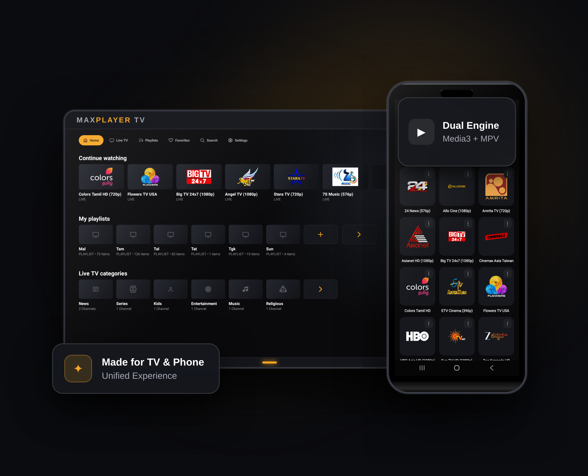

<p align="center">
  
</p>

# MaxPlayer IPTV

**Your media. Your way.**

MaxPlayer is an open-source media player for Android phones, tablets, and Android TV. It brings live TV, movies, series, playlists, and audio streaming together in one application, with a choice of playback engines.

## Project Website

**[Visit the MaxPlayer Website](https://mr-bipolar.github.io/maxplayer-website/index.html)**

For complete project information, screenshots, features, downloads, support, and updates, visit the official website.

## Developer Documentation

- [Building and installing](docs/BUILDING.md) — environment setup, Gradle build, APK output, and installation.
- [Testing](docs/TESTING.md) — database, playlist parser, security, and full local test commands.
- [Platform support](docs/PLATFORM_SUPPORT.md) — Android versions, ABIs, and Android TV support.
- [Contributing](CONTRIBUTING.md) — workflow, coding conventions, commits, and pull requests.

Quick start after installing the Android SDK components listed in the [building guide](docs/BUILDING.md):

```bash
git clone https://github.com/mr-bipolar/maxPlayer-iptv.git
cd maxPlayer-iptv
./gradlew :app:assembleDebug
./gradlew :app:test
```

The debug APK is written to `app/build/outputs/apk/debug/app-debug.apk`. On Windows, use `gradlew.bat` instead of `./gradlew`.

## Playback Engines

MaxPlayer supports two playback engines:

- **Media3 (ExoPlayer)** – Google's Android media playback library.
- **MPV** – An alternative playback engine powered by `libmpv`, integrated through our reusable Java-based Android engine.

## MPV Credits & Acknowledgements

MaxPlayer uses the open-source **[MPV](https://github.com/mpv-player/mpv)** media player project and the Android integration maintained by **[mpv-android](https://github.com/mpv-android/mpv-android)**.

We appreciate the work of the MPV and mpv-android contributors.

### MPV Android Engine

MaxPlayer also uses our own reusable Android playback library:

**[MPV Android Engine – GitHub Repository](https://github.com/mr-bipolar/mpv-android-engine)**

The engine provides a Java API wrapping `libmpv` for Android applications. It handles the native playback integration while allowing the host application to own its UI and video rendering surface.

**Upstream component details:**

| Component | Version / Reference |
|---|---|
| MPV core | `0.41.0-UNKNOWN` |
| Android integration | [mpv-android](https://github.com/mpv-android/mpv-android) |
| Integration release | [2026-09-17](https://github.com/mpv-android/mpv-android/releases/tag/2026-09-17) |
| Integration commit | `c2e02fe111541e4063ab8f868bf629649ed937a3` |

The MPV core version is taken from the upstream Android build scripts at `buildscripts/deps/mpv/MPV_VERSION`.

For engine documentation, integration instructions, build details, and licensing information, visit the [MPV Android Engine repository](https://github.com/mr-bipolar/mpv-android-engine).

## Content Disclaimer

MaxPlayer is a media player application. It does not provide, host, bundle, or sell television channels, playlists, or copyrighted media content. Users must provide their own playlists and authorized media streams.

## License & Third-Party Notices

MaxPlayer incorporates third-party software and native components. Each dependency may have its own license and redistribution requirements.

This repository does not currently include a top-level `LICENSE` or `NOTICE` file. Please review the relevant upstream licenses and notices — including the [MPV Android Engine repository](https://github.com/mr-bipolar/mpv-android-engine) — before using, modifying, or redistributing this project or its bundled components.